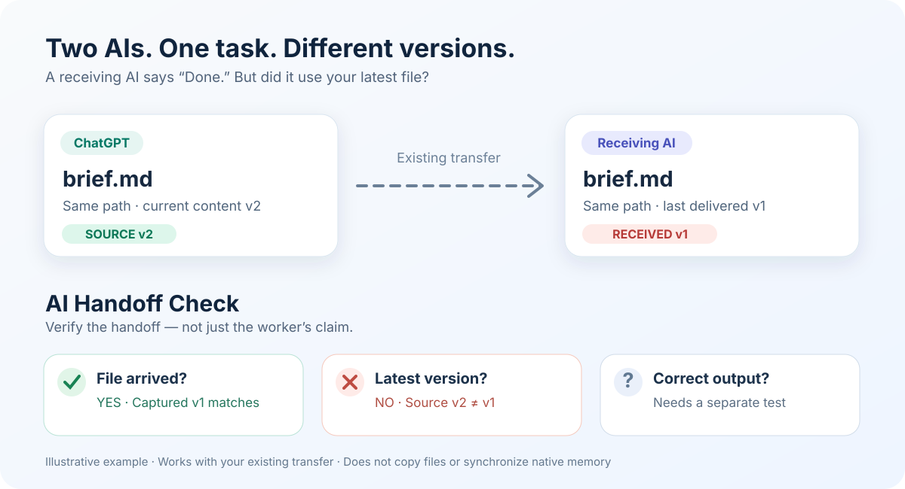

# AI Handoff Check · AI 交接检查器

[English](README.md) · [安装指南](install.md) · [MIT 许可证](LICENSE) · [持续测试](https://github.com/runesleo/ai-handoff-check/actions/workflows/ci.yml)

**两个 AI 都说“完成了”。但它们用的是同一版文件吗？**



## 20 秒看懂它有什么用

假设你让 **ChatGPT** 整理了 `brief.md`（内容版本 v1），通过已有工具交给 **Grok Bot** 接着做。你随后在**同一个文件路径** `brief.md` 内把内容更新到 v2，但 Grok 手里仍是旧版 v1。检查器能识别这次内容变化；它不会自动发现旁边另存的新文件名。

| 问题 | 检查结果 |
|---|---|
| 旧文件真的送到了吗？ | **✓ 是。** v1 字节完整一致 |
| 接收端是最新版吗？ | **✕ 否。** 来源 v2、接收 v1 |
| 对方真的用对内容了吗？ | **还不能证明。** 需要独立验证任务产物 |

最重要的区别是：**文件曾经正确送达，不等于现在仍然是正确版本。**

**[直接打开三步在线演示](https://runesleo.github.io/ai-handoff-check/)**：无需安装或登录，即可点击「发送 v1 → 来源改 v2 → 经现有传输重交并验收」。这是可视化示例，不是真实账号联动；也可以下载仓库离线打开 `demo/index.html`。


## 让你的 AI 帮你安装

把这段话直接发给 Claude Code、Codex 或其他支持 Skills 的 AI：

> 按照 [官方安装说明](https://github.com/runesleo/ai-handoff-check/blob/main/install.md) 安装 **AI Handoff Check**。先运行只读 doctor 自检；不要自动传输私人文件、登录账号或修改安全设置。

也可以直接克隆仓库，运行本地自检和离线例子，不需要任何服务商账号。

## 一分钟上手

Python 3.10+，macOS/Linux；无需安装依赖、登录账户或配置 API Key。

```sh
python3 scripts/handoff.py demo
```

会看到三种状态：文件已送达、旧版已过期、目标文件已损坏。它们不是同一种「完成」。

作为 Skill 使用时，复制完整文件夹到你的 AI 支持的 Skills 目录（见 [安装说明](install.md)），然后告诉它：

> 用 AI Handoff Check 核对刚才给另一个 AI 的资料。沿用现有传输，验证文件是否完整、是不是最新版，再独立核实执行结果。结果不明不要重复派发。

## 实际工作怎么走

1. 用 `prepare` 固定源文件内容、版本及哈希，把清单存进**原任务**的证据目录。
2. 用你**原本已经授权的工具**交接文件。本 Skill 不负责跨平台上传。
3. 收到后用保存的可信哈希执行 `verify`；加 `--require-current` 可以发现来源已经更新。
4. 再独立检查任务产物是否用了正确内容。文件一致本身**不能证明 AI 理解正确**。

```sh
python3 scripts/handoff.py prepare --run-id example-1 --run-root ./evidence/example-1 --source context=./context.md
# 经现有工具交付；先把准备阶段返回的SHA256保存在原任务里
python3 scripts/handoff.py verify --manifest ./evidence/example-1/manifest.json --expect-sha256 "$PINNED_MANIFEST_SHA256" --require-current
```

## 能力边界

背后的原工作流已经真实验证两轮无敏感的 AI 文件交接及来源换版；**这个可分发包**完成了 21 项本地测试和离线示例，尚未验证所有 AI 平台兼容。

它**不是一键同步器**，不自带 ChatGPT/Grok 跨账户传输、不迁移原生记忆、不自动续接未授权任务、不增加定时服务。支持每轮 1–16 个本地文件，单文件上限 32 MiB。Manifest 含本地路径，不要放到公开 issue 中。

## 希望你反馈什么

如果你真的在自己的工作流里安装、交接并通过检查，欢迎在 GitHub Issue 分享第一次跑通的情况、使用了哪种 AI、卡在哪里。**不要上传包含私人路径的 manifest、账号信息或真实文件。** Star 是关注信号，独立使用案例才是复用证据。

未来可能根据实际需求补更多传输适配示例和回执能力；目前不承诺托管 SaaS。

## 关于作者

由 [Leo](https://x.com/runes_leo) 独立构建，更多 AI 工作流实验见 [leolabs.me](https://leolabs.me)。

详见 [干净环境首次成功记录](docs/FIRST_SUCCESS.md)、[协议说明](references/protocol.md)、[独立审查](REVIEW-codex-pass.md)。[MIT License](LICENSE)。
